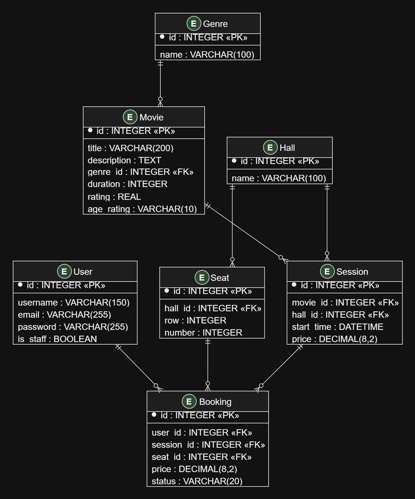

# CinemaHub

CinemaHub -- це сайт кінотеатру, на якому можна переглядати фільми, дізнаватися розклад сеансів і бронювати місця.

Я вирішив зробити сайт для одного кінотеатру з декількома залами. Ідея полягає в тому, 
щоб людина могла вибрати фільм, подивитися, коли він іде, та забронювати місце, не звертаючись до каси.
На головній сторінці буде список фільмів. Їх можна буде шукати за назвою, фільтрувати за жанром і сортувати за 
рейтингом або назвою. На сторінці фільму буде його опис, тривалість, жанр, вікове обмеження та доступні сеанси.

Також планую зробити:
- Перегляд розкладу на вибрану дату.
- Перегляд вільних і зайнятих місць.
- Реєстрацію та вхід користувачів.
- Бронювання місць.
- Особистий кабінет з історією бронювань.
- Можливість скасувати бронювання.
- Редагування даних профілю.

Фільми, жанри, зали та сеанси адміністратор зможе додавати й редагувати через стандартну адміністративну панель Django.

## REST API

Для обміну даними між сайтом і сервером планую використовувати REST API. Дані передаватимуться у форматі JSON.

Основні методи:
- `GET` -- отримання даних.
- `POST` -- створення запису.
- `PATCH` -- зміна даних.
- `DELETE` -- видалення або скасування.

У прикладах `{id}` -- це ID конкретного запису.

### 1. Фільми

**GET /api/movies/**

Повертає список фільмів.

Параметри:
- `search`  -- пошук за назвою.
- `genre_id` -- фільтр за жанром.
- `ordering` -- сортування (`title`, `-title`, `rating`, `-rating`).

Приклад: `/api/movies/?genre_id=1&ordering=-rating`

Відповідь: `200 OK`

```json
[
  {
    "id": 1,
    "title": "Interstellar",
    "genre_id": 1,
    "duration": 169,
    "rating": 8.7
  }
]
```

**GET /api/movies/{id}/**

Повертає детальну інформацію про фільм.

Відповідь: `200 OK`

```json
{
  "id": 1,
  "title": "Interstellar",
  "description": "Фантастичний фільм про космічну подорож",
  "genre_id": 1,
  "duration": 169,
  "rating": 8.7,
  "age_rating": "12+"
}
```

### 2. Жанри

**GET /api/genres/**

Повертає список жанрів.

Відповідь: `200 OK`

```json
[
  {"id": 1, "name": "Фантастика"},
  {"id": 2, "name": "Комедія"},
  {"id": 3, "name": "Драма"}
]
```

**GET /api/genres/{id}/**

Повертає інформацію про конкретний жанр.

Відповідь: `200 OK`

```json
{
  "id": 1,
  "name": "Фантастика"
}
```

### 3. Зали та місця

**GET /api/halls/**

Повертає список залів кінотеатру.

Відповідь: `200 OK`

```json
[
  {"id": 1, "name": "Зал 1"},
  {"id": 2, "name": "Зал 2"}
]
```

**GET /api/halls/{id}/seats/**

Повертає місця конкретного залу. Їхня зайнятість залежить від сеансу, тому тут показується лише розташування.

Відповідь: `200 OK`

```json
[
  {"id": 1, "row": 1, "number": 1},
  {"id": 2, "row": 1, "number": 2}
]
```

### 4. Сеанси

**GET /api/sessions/**

Повертає список сеансів.

Параметри:
- `movie_id` — сеанси конкретного фільму.
- `date` — сеанси на вибрану дату.

Приклад: `/api/sessions/?movie_id=1&date=2026-10-20`

Відповідь: `200 OK`

```json
[
  {
    "id": 1,
    "movie_id": 1,
    "hall_id": 1,
    "start_time": "2026-10-20T18:00:00+03:00",
    "price": 200
  }
]
```

**GET /api/sessions/{id}/**

Повертає інформацію про конкретний сеанс.

Відповідь: `200 OK`

```json
{
  "id": 1,
  "movie_id": 1,
  "hall_id": 1,
  "start_time": "2026-10-20T18:00:00+03:00",
  "price": 200
}
```

**GET /api/sessions/{id}/seats/**

Повертає місця залу та показує, які з них вільні на конкретний сеанс.

Відповідь: `200 OK`

```json
[
  {
    "id": 1,
    "row": 1,
    "number": 1,
    "is_available": true
  },
  {
    "id": 2,
    "row": 1,
    "number": 2,
    "is_available": false
  }
]
```

### 5. Користувачі

**POST /api/auth/register/**

Реєструє нового користувача.

Запит:

```json
{
  "username": "user123",
  "email": "user@example.com",
  "password": "example123"
}
```

Відповідь: `201 Created`

```json
{
  "id": 1,
  "username": "user123",
  "email": "user@example.com"
}
```

**POST /api/auth/login/**

Вхід в обліковий запис.

Запит:

```json
{
  "username": "user123",
  "password": "example123"
}
```

Відповідь: `200 OK`

```json
{
  "message": "Login successful"
}
```

**POST /api/auth/logout/**

Вихід з облікового запису. Тіло запиту відсутнє.

Відповідь: `200 OK`

```json
{
  "message": "Logout successful"
}
```

**GET /api/users/me/**

Повертає інформацію про поточного користувача.

Відповідь: `200 OK`

```json
{
  "id": 1,
  "username": "user123",
  "email": "user@example.com"
}
```

**PATCH /api/users/me/**

Змінює дані профілю.

Запит:

```json
{
  "email": "new@example.com"
}
```

Відповідь: `200 OK`

```json
{
  "id": 1,
  "username": "user123",
  "email": "new@example.com"
}
```

Для авторизації планую використати стандартні сесії Django. Паролі не будуть повертатися у відповідях API.

### 6. Бронювання

Для спрощення одне бронювання буде відповідати одному місцю на одному сеансі. 
Якщо користувачу потрібно декілька місць, він зможе забронювати їх окремо.

**GET /api/bookings/**

Повертає історію бронювань поточного користувача.

Відповідь: `200 OK`

```json
[
  {
    "id": 1,
    "session_id": 1,
    "seat_id": 2,
    "price": 200,
    "status": "confirmed"
  }
]
```

**POST /api/bookings/**

Створює бронювання. Користувач вибирає сеанс і місце.

Запит:

```json
{
  "session_id": 1,
  "seat_id": 2
}
```

Відповідь: `201 Created`

```json
{
  "id": 1,
  "session_id": 1,
  "seat_id": 2,
  "price": 200,
  "status": "confirmed"
}
```

Якщо місце вже зайняте, сервер повертає `409 Conflict`:

```json
{
  "error": "Seat is already booked"
}
```

**DELETE /api/bookings/{id}/**

Скасовує бронювання користувача. Запис залишається в історії, але місце знову стає доступним.

Тіло запиту відсутнє.

Відповідь: `200 OK`

```json
{
  "id": 1,
  "status": "cancelled"
}
```


### Обробка помилок

Якщо користувач запитує неіснуючий фільм або сеанс, сервер повертає `404 Not Found`. Якщо вибране місце вже заброньоване, 
повертається `409 Conflict`. Інші помилки планую обробляти під час реалізації API.

## База даних

Для зберігання даних планую використовувати SQLite. На початку достатньо семи основних таблиць.

### Зв'язки між таблицями

- Один жанр може мати багато фільмів, але кожен фільм має один основний жанр.
- Один фільм може мати багато сеансів.
- Один зал має багато місць.
- Один зал може використовуватися для багатьох сеансів.
- Один користувач може створювати багато бронювань.
- Кожне бронювання пов'язане з користувачем, сеансом і конкретним місцем.

Зайнятість місця визначатиметься за активними бронюваннями на відповідний сеанс, а не зберігатиметься окремо в таблиці місць.

### Схема бази даних


