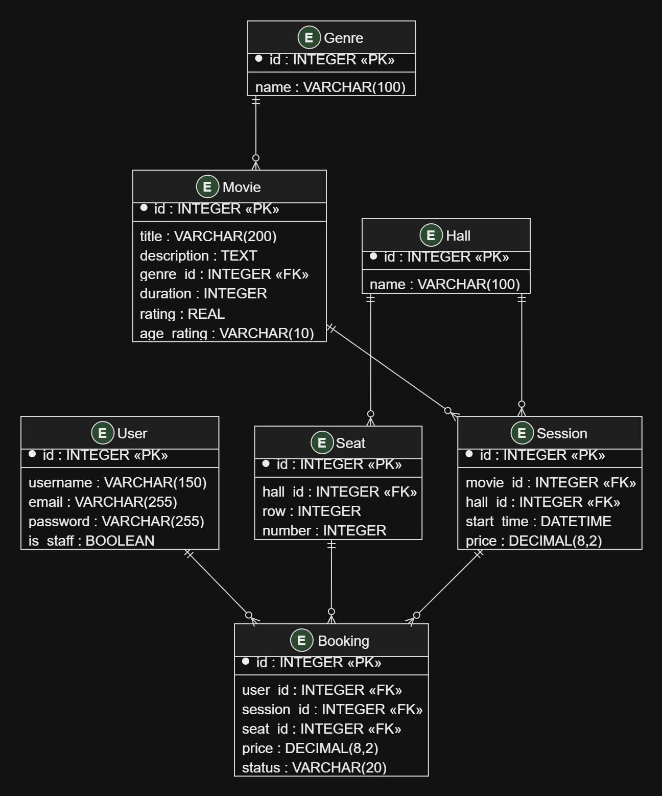

# CinemaHub

CinemaHub -- це сайт кінотеатру, на якому можна переглядати фільми, дізнаватися розклад сеансів, а в майбутньому бронювати місця.

Я вирішив зробити сайт для одного кінотеатру з декількома залами. Ідея полягає в тому,
щоб людина могла вибрати фільм, подивитися, коли він іде, та в майбутньому забронювати місце, не звертаючись до каси.

На головній сторінці є список фільмів. Їх можна шукати за назвою, фільтрувати за жанром і сортувати за
рейтингом або назвою. Також можна переглядати інформацію про фільми, зали, місця та сеанси.

У попередніх лабораторних я зробив REST API для роботи з даними кінотеатру, а в цій роботі додав реєстрацію, вхід користувачів та права доступу.

Зараз реалізовано:
- Перегляд фільмів, жанрів, залів, місць і сеансів.
- Пошук фільмів, фільтрацію та сортування.
- Перегляд розкладу на вибрану дату.
- Реєстрацію та вхід користувачів.
- Перегляд інформації про свій профіль.
- Авторизацію через JWT.
- Оновлення токена та вихід з облікового запису.
- Створення, редагування та видалення даних адміністратором.

Також планую зробити:
- Бронювання місць.
- Особистий кабінет з історією бронювань.
- Можливість скасувати бронювання.
- Редагування даних профілю.

Фільми, жанри, зали та сеанси адміністратор може додавати й редагувати через Django Admin або REST API.

## Технології

Для бекенду використовую Python 3.12, Django 6.0.9, Django REST Framework та SQLite.

Для підключення фронтенду використовується django-cors-headers, а для авторизації -- JWT.

Фронтенд зроблений на HTML, CSS та JavaScript і знаходиться в окремому репозиторії.

## Запуск проєкту

Щоб запустити бекенд, потрібно відкрити PowerShell у папці проєкту та виконати:

```powershell
py -3.12 -m venv .venv
.\.venv\Scripts\Activate.ps1
python -m pip install -r requirements.txt
python manage.py migrate
python manage.py seed_demo
python manage.py runserver
```

Команда `seed_demo` додає демонстраційні дані для перевірки роботи сайту.

Після запуску API буде доступне за адресою:

`http://127.0.0.1:8000/api/`

Перевірити роботу бекенду можна командами:

```powershell
python manage.py check
python manage.py test
```

## REST API

Для обміну даними між сайтом і сервером використовую REST API. Дані передаються у форматі JSON.

Основні методи:
- `GET` -- отримання даних.
- `POST` -- створення запису.
- `PATCH` -- зміна даних.
- `DELETE` -- видалення.

У прикладах `{id}` -- це ID конкретного запису.

Для запитів із JSON використовується заголовок:

`Content-Type: application/json`

Переглядати фільми, жанри, зали, місця та сеанси можна без авторизації.

А от створювати, редагувати та видаляти їх може тільки адміністратор, тобто користувач із правами `is_staff`.

Для цього потрібно передати access-токен у заголовку:

`Authorization: Bearer <access_token>`

Якщо токена немає або він неправильний, сервер поверне `401 Unauthorized`.

Якщо користувач авторизований, але не має прав адміністратора, сервер поверне `403 Forbidden`.

### 1. Фільми

**GET /api/movies/**

Повертає список фільмів.

Параметри:
- `search` -- пошук за назвою.
- `genre_id` -- фільтр за жанром.
- `ordering` -- сортування (`title`, `-title`, `rating`, `-rating`).

Приклад: `/api/movies/?genre_id=1&ordering=-rating`

Відповідь: `200 OK`

```json
[
  {
    "id": 1,
    "title": "Interstellar",
    "genre_id": 1,
    "duration": 169,
    "rating": 8.7
  }
]
```

**GET /api/movies/{id}/**

Повертає детальну інформацію про фільм.

Відповідь: `200 OK`

```json
{
  "id": 1,
  "title": "Interstellar",
  "description": "Фантастичний фільм про космічну подорож",
  "genre_id": 1,
  "duration": 169,
  "rating": 8.7,
  "age_rating": "12+"
}
```

**POST /api/movies/**

Створює новий фільм. Доступний тільки адміністратору.

Заголовки:
- `Content-Type: application/json`
- `Authorization: Bearer <access_token>`

Запит:

```json
{
  "title": "Interstellar",
  "description": "Фантастичний фільм про космічну подорож",
  "genre_id": 1,
  "duration": 169,
  "rating": 8.7,
  "age_rating": "12+"
}
```

Відповідь: `201 Created`

```json
{
  "id": 1,
  "title": "Interstellar",
  "description": "Фантастичний фільм про космічну подорож",
  "genre_id": 1,
  "duration": 169,
  "rating": 8.7,
  "age_rating": "12+"
}
```

**PATCH /api/movies/{id}/**

Змінює дані фільму. Можна передавати тільки ті поля, які потрібно оновити.

Запит:

```json
{
  "rating": 9.0
}
```

Відповідь: `200 OK` з оновленими даними фільму.

**DELETE /api/movies/{id}/**

Видаляє фільм.

Тіло запиту відсутнє.

Відповідь: `204 No Content`.

Якщо фільм має пов'язані сеанси, сервер поверне `409 Conflict`.

### 2. Жанри

**GET /api/genres/**

Повертає список жанрів.

Відповідь: `200 OK`

```json
[
  {"id": 1, "name": "Фантастика"},
  {"id": 2, "name": "Комедія"},
  {"id": 3, "name": "Драма"}
]
```

**GET /api/genres/{id}/**

Повертає інформацію про конкретний жанр.

Відповідь: `200 OK`

```json
{
  "id": 1,
  "name": "Фантастика"
}
```

**POST /api/genres/**

Створює новий жанр.

Запит:

```json
{
  "name": "Детектив"
}
```

Відповідь: `201 Created`

```json
{
  "id": 4,
  "name": "Детектив"
}
```

**PATCH /api/genres/{id}/**

Змінює назву жанру.

Запит:

```json
{
  "name": "Пригоди"
}
```

Відповідь: `200 OK` з оновленими даними.

**DELETE /api/genres/{id}/**

Видаляє жанр. Тіло запиту відсутнє.

Відповідь: `204 No Content`.

Якщо жанр використовується у фільмах, сервер поверне `409 Conflict`.

### 3. Зали та місця

**GET /api/halls/**

Повертає список залів кінотеатру.

Відповідь: `200 OK`

```json
[
  {"id": 1, "name": "Зал 1"},
  {"id": 2, "name": "Зал 2"}
]
```

**GET /api/halls/{id}/**

Повертає інформацію про конкретний зал.

Відповідь: `200 OK`

```json
{
  "id": 1,
  "name": "Зал 1"
}
```

**POST /api/halls/**

Створює новий зал.

Запит:

```json
{
  "name": "Зал 3"
}
```

Відповідь: `201 Created` з ID та назвою нового залу.

**PATCH /api/halls/{id}/**

Змінює дані залу.

Запит:

```json
{
  "name": "Великий зал"
}
```

Відповідь: `200 OK` з оновленими даними.

**DELETE /api/halls/{id}/**

Видаляє зал.

Відповідь: `204 No Content`.

Якщо зал має місця або сеанси, сервер поверне `409 Conflict`.

**GET /api/halls/{id}/seats/**

Повертає місця конкретного залу. Їхня зайнятість залежить від сеансу, тому тут показується лише розташування.

Відповідь: `200 OK`

```json
[
  {"id": 1, "row": 1, "number": 1},
  {"id": 2, "row": 1, "number": 2}
]
```

**GET /api/seats/**

Повертає список усіх місць.

Відповідь: `200 OK`

```json
[
  {"id": 1, "hall_id": 1, "row": 1, "number": 1},
  {"id": 2, "hall_id": 1, "row": 1, "number": 2}
]
```

**GET /api/seats/{id}/**

Повертає інформацію про конкретне місце.

Відповідь: `200 OK`

```json
{
  "id": 1,
  "hall_id": 1,
  "row": 1,
  "number": 1
}
```

**POST /api/seats/**

Додає місце до залу.

Запит:

```json
{
  "hall_id": 1,
  "row": 2,
  "number": 5
}
```

Відповідь: `201 Created` з даними нового місця.

**PATCH /api/seats/{id}/**

Змінює інформацію про місце.

Запит:

```json
{
  "number": 6
}
```

Відповідь: `200 OK` з оновленими даними.

**DELETE /api/seats/{id}/**

Видаляє місце.

Відповідь: `204 No Content`.

У межах одного залу не може бути двох місць з однаковим рядом і номером.

### 4. Сеанси

**GET /api/sessions/**

Повертає список сеансів.

Параметри:
- `movie_id` -- сеанси конкретного фільму.
- `date` -- сеанси на вибрану дату у форматі `YYYY-MM-DD`.

Приклад: `/api/sessions/?movie_id=1&date=2026-10-20`

Відповідь: `200 OK`

```json
[
  {
    "id": 1,
    "movie_id": 1,
    "hall_id": 1,
    "start_time": "2026-10-20T18:00:00+03:00",
    "price": 200
  }
]
```

**GET /api/sessions/{id}/**

Повертає інформацію про конкретний сеанс.

Відповідь: `200 OK`

```json
{
  "id": 1,
  "movie_id": 1,
  "hall_id": 1,
  "start_time": "2026-10-20T18:00:00+03:00",
  "price": 200
}
```

**POST /api/sessions/**

Створює новий сеанс.

Запит:

```json
{
  "movie_id": 1,
  "hall_id": 1,
  "start_time": "2026-10-20T18:00:00+03:00",
  "price": 200
}
```

Відповідь: `201 Created` з даними створеного сеансу.

**PATCH /api/sessions/{id}/**

Змінює інформацію про сеанс.

Запит:

```json
{
  "price": 250
}
```

Відповідь: `200 OK` з оновленими даними.

**DELETE /api/sessions/{id}/**

Видаляє сеанс.

Відповідь: `204 No Content`.

Сеанси не повинні перетинатися за часом в одному залі.

**GET /api/sessions/{id}/seats/**

Повертає місця залу та показує, які з них вільні на конкретний сеанс.

Відповідь: `200 OK`

```json
[
  {
    "id": 1,
    "row": 1,
    "number": 1,
    "is_available": true
  },
  {
    "id": 2,
    "row": 1,
    "number": 2,
    "is_available": true
  }
]
```

Зараз бронювання ще не реалізовано, тому всі місця вважаються вільними.

### 5. Користувачі

У цій лабораторній я додав окремий Django app `users`, у якому знаходиться функціонал реєстрації, входу та роботи з користувачами.

Для авторизації використовується JWT. Після входу користувач отримує два токени:
- `access` -- використовується для захищених запитів.
- `refresh` -- потрібен для оновлення access-токена.

**POST /api/auth/register/**

Реєструє нового користувача.

Авторизація не потрібна.

Заголовок: `Content-Type: application/json`

Запит:

```json
{
  "username": "user123",
  "first_name": "Ivan",
  "last_name": "Petrenko",
  "email": "user@example.com",
  "password": "Example123!",
  "password_confirmation": "Example123!"
}
```

Обов'язкові поля:
- `username`
- `email`
- `password`
- `password_confirmation`

Ім'я та прізвище можна не заповнювати.

Під час реєстрації перевіряється правильність email, довжина полів, унікальність username та email, складність пароля і збіг двох паролів.

Максимальна довжина username -- 150 символів, email -- 254, імені та прізвища -- 150, пароля та його підтвердження -- 128.

Відповідь: `201 Created`

```json
{
  "user": {
    "id": 1,
    "username": "user123",
    "email": "user@example.com",
    "first_name": "Ivan",
    "last_name": "Petrenko"
  },
  "access": "<access_token>",
  "refresh": "<refresh_token>"
}
```

Якщо дані неправильні, сервер повертає `400 Bad Request` з помилками відповідних полів.

Пароль зберігається у вигляді хешу та не повертається у відповіді API.

**POST /api/auth/login/**

Вхід в обліковий запис.

Авторизація не потрібна.

Заголовок: `Content-Type: application/json`

Запит:

```json
{
  "username": "user123",
  "password": "Example123!"
}
```

Відповідь: `200 OK`

```json
{
  "access": "<access_token>",
  "refresh": "<refresh_token>"
}
```

Якщо username або пароль неправильні, сервер повертає `401 Unauthorized`.

**POST /api/auth/refresh/**

Оновлює access-токен без повторного входу користувача.

Заголовок: `Content-Type: application/json`

Запит:

```json
{
  "refresh": "<refresh_token>"
}
```

Відповідь: `200 OK`

```json
{
  "access": "<new_access_token>"
}
```

Якщо refresh-токен неправильний або вже не діє, сервер повертає `401 Unauthorized`.

**POST /api/auth/logout/**

Вихід з облікового запису.

Потрібен заголовок:

`Authorization: Bearer <access_token>`

Тіло запиту відсутнє.

Відповідь: `204 No Content`.

Після виходу фронтенд видаляє збережені токени. У поточній реалізації вихід не відкликає refresh-токен на сервері.

**GET /api/users/me/**

Повертає інформацію про поточного користувача.

Потрібен заголовок:

`Authorization: Bearer <access_token>`

Відповідь: `200 OK`

```json
{
  "id": 1,
  "username": "user123",
  "email": "user@example.com",
  "first_name": "Ivan",
  "last_name": "Petrenko",
  "role": "user"
}
```

Якщо токена немає або він недійсний, сервер повертає `401 Unauthorized`.

Редагування профілю поки не реалізовано.

### 6. Бронювання

Бронювання залишилося в планах на майбутнє. У поточній версії API endpoint-ів для бронювання ще немає.

Для спрощення одне бронювання буде відповідати одному місцю на одному сеансі.
Якщо користувачу потрібно декілька місць, він зможе забронювати їх окремо.

Планую додати:
- `GET /api/bookings/` -- історія бронювань користувача.
- `POST /api/bookings/` -- створення бронювання.
- `DELETE /api/bookings/{id}/` -- скасування бронювання.

Якщо місце вже зайняте, сервер повинен буде повертати `409 Conflict`.

При скасуванні бронювання запис залишатиметься в історії, але місце знову стане доступним.

### Обробка помилок

У попередніх лабораторних я додав перевірку даних та обробку помилок API.

Основні статуси:
- `200 OK` -- успішне отримання або редагування даних.
- `201 Created` -- запис створено.
- `204 No Content` -- успішне видалення або вихід.
- `400 Bad Request` -- неправильні дані.
- `401 Unauthorized` -- немає авторизації або токен неправильний.
- `403 Forbidden` -- користувач не має потрібних прав.
- `404 Not Found` -- об'єкт не знайдено.
- `409 Conflict` -- операція конфліктує з наявними даними.

Наприклад, якщо передати неправильну тривалість фільму, сервер поверне `400 Bad Request`.

```json
{
  "error": {
    "code": "bad_request",
    "message": "Request data is invalid.",
    "details": {
      "duration": [
        "Ensure this value is greater than or equal to 1."
      ]
    }
  }
}
```

Тривалість фільму повинна бути від 1 до 600 хвилин, рейтинг -- від 0 до 10, ціна -- додатною.

Якщо спробувати видалити жанр, до якого прив'язані фільми, сервер поверне `409 Conflict`.

## База даних

Для зберігання даних використовую SQLite. Django ORM дозволяє працювати з таблицями через моделі.

У попередній роботі я спроєктував базу даних для кінотеатру. Частина моделей уже реалізована, а бронювання залишилося на майбутнє.

### Зв'язки між таблицями

- Один жанр може мати багато фільмів, але кожен фільм має один основний жанр.
- Один фільм може мати багато сеансів.
- Один зал має багато місць.
- Один зал може використовуватися для багатьох сеансів.
- Один користувач може створювати багато бронювань (планується).
- Кожне бронювання буде пов'язане з користувачем, сеансом і конкретним місцем (планується).

Зайнятість місця в майбутньому визначатиметься за активними бронюваннями на відповідний сеанс, а не зберігатиметься окремо в таблиці місць.

### Схема бази даних



## CORS

Фронтенд і бекенд знаходяться в різних репозиторіях, тому для їхньої взаємодії використовується CORS.

Бекенд дозволяє запити з `http://localhost:5173` через налаштування `CORS_ALLOWED_ORIGINS`.

## Postman

Для перевірки API використовую Postman.

Колекція знаходиться у файлі:

`postman/CinemaHub.postman_collection.json`

У ній є запити для роботи з фільмами, жанрами, залами, місцями та сеансами, а також запити для реєстрації, входу, оновлення токена, виходу та перегляду профілю.

Для роботи потрібно встановити змінну `base_url`:

`http://127.0.0.1:8000`

Після входу потрібно зберегти access-токен у змінну `access_token`.

Для захищених запитів використовується заголовок:

`Authorization: Bearer {{access_token}}`

Публічні GET-запити можна виконувати без токена.

## Фронтенд

На фронтенді є сторінки реєстрації, входу та профілю.

Якщо користувач відкриває захищену сторінку без авторизації, його перенаправляє на сторінку входу. Після успішного входу він може повернутися на сторінку, яку хотів відкрити.

Після входу в навігації показується username та кнопка виходу. Токени зберігаються в `sessionStorage`, а access-токен може автоматично оновлюватися через refresh.

Після виходу токени видаляються, тому для повторного відкриття профілю потрібно знову авторизуватися.